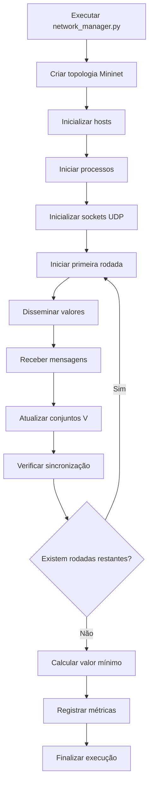

# Guia de Execução

## 1. Sobre o projeto

Este projeto implementa um protótipo experimental de uma arquitetura orientada a eventos para execução do algoritmo **Flooding-Based Consensus**.

A infraestrutura utiliza:
- **Python** para implementação dos processos.
- **Mininet** para emulação da rede.
- **UDP** para comunicação entre processos.
- **Asyncio** para tratamento de eventos.
- **JSON** para serialização das mensagens.
- **CSV** para armazenamento das métricas.

---

## 2. Pré-requisitos

O ambiente recomendado é Linux, preferencialmente Ubuntu. Instale os seguintes componentes:

### 2.1. Python

Verifique a versão instalada:
```bash
python3 --version
```
> **Nota:** Recomenda-se Python 3.10 ou superior.

### 2.2. Mininet

Instale o Mininet:
```bash
sudo apt update
sudo apt install mininet
```

Verifique a instalação:
```bash
sudo mn --test pingall
```
> O resultado esperado é a comunicação bem-sucedida entre os hosts de teste.

### 2.3. Git

Caso utilize Git para controlar o projeto:
```bash
sudo apt install git
```

---

## 3. Preparação do ambiente

Crie o diretório raiz do projeto e acesse-o:
```bash
mkdir flooding-consensus
cd flooding-consensus
```

Crie a estrutura de diretórios:
```bash
mkdir consensus
mkdir events
mkdir communication
mkdir mininet
mkdir experiments
mkdir results
mkdir results/logs
mkdir results/metrics
mkdir docs
```

Crie os arquivos `__init__.py` para definir os pacotes Python:
```bash
touch consensus/__init__.py
touch events/__init__.py
touch communication/__init__.py
touch mininet/__init__.py
touch experiments/__init__.py
```

Agora, adicione os códigos Python apresentados na documentação aos respectivos arquivos.

---

## 4. Instalação das dependências

Instale as dependências diretamente:
```bash
pip install -r requirements.txt
```

Caso utilize um ambiente virtual (`venv`):
```bash
python3 -m venv venv
source venv/bin/activate
pip install -r requirements.txt
```

> **Importante:** O Mininet deve estar instalado diretamente no sistema operacional, pois depende de componentes do kernel do Linux e de privilégios administrativos.

---

## 5. Configuração do experimento

O experimento pode ser configurado por meio dos parâmetros passados ao script `network_manager.py`.

### Principais parâmetros

| Parâmetro | Descrição | Exemplo |
| :--- | :--- | :--- |
| `--n` | Quantidade de processos | `5` |
| `--f` | Limite máximo de falhas | `1` |

### Exemplo de configuração

```bash
sudo python3 mininet/network_manager.py --n 5 --f 1
```

Nesse exemplo:
- Serão criados cinco hosts virtuais.
- Cada host executará um processo independente.
- O algoritmo será configurado para tolerar até uma falha.
- Serão executadas duas rodadas.

A quantidade de rodadas ($R$) é determinada pela fórmula:
$$R = f + 1$$

Portanto:
$$R = 1 + 1 = 2$$

---

## 6. Executando o projeto

Com os arquivos criados e as dependências instaladas, execute:
```bash
sudo python3 mininet/network_manager.py --n 5 --f 1
```

O Mininet criará a topologia de rede e iniciará os processos. Cada host receberá um identificador e um valor inicial.

### Exemplo de distribuição inicial

| Processo | Valor inicial |
| :--- | :--- |
| `P1` | `10` |
| `P2` | `20` |
| `P3` | `30` |
| `P4` | `40` |
| `P5` | `50` |

Cada processo executará sua própria instância do algoritmo.

### 6.1. Fluxo esperado



---

## 7. Acessando os hosts do Mininet

Durante a execução, o Mininet disponibilizará seu terminal interativo (`mininet>`). Alguns comandos úteis:

### 7.1. Verificar os hosts
```bash
mininet> nodes
```

### 7.2. Verificar a conectividade
```bash
mininet> pingall
```

### 7.3. Consultar endereços IP
```bash
mininet> dump
```

### 7.4. Consultar processos em um host específico
```bash
mininet> h1 ps aux
```

### 7.5. Sair do Mininet
```bash
mininet> exit
```

---

## 8. Consultando os resultados

Os resultados gerados durante a execução serão armazenados na seguinte estrutura de diretórios:

```text
results/
│
├── logs/
│   ├── process_1.log
│   ├── process_2.log
│   ├── process_3.log
│   ├── process_4.log
│   └── process_5.log
│
└── metrics/
    ├── process_1.csv
    ├── process_2.csv
    ├── process_3.csv
    ├── process_4.csv
    └── process_5.csv
```

### 8.1. Consultar os logs

Para consultar o resultado do primeiro processo:
```bash
cat results/logs/process_1.log
```

Para consultar todos os logs simultaneamente:
```bash
cat results/logs/*.log
```

### 8.2. Consultar as métricas

Para consultar as métricas do primeiro processo:
```bash
cat results/metrics/process_1.csv
```

Os arquivos CSV apresentam as seguintes colunas/informações:
- Identificador do processo.
- Tempo de execução.
- Mensagens enviadas.
- Mensagens recebidas.
- Rodadas executadas.
- Decisão calculada.
- Indicador de sucesso da execução.

---

## 9. Executando diferentes configurações

É possível executar experimentos modificando a quantidade de processos (`--n`) e o limite de falhas (`--f`).

### Experimento 1 — Cinco processos e uma falha
```bash
sudo python3 mininet/network_manager.py --n 5 --f 1
```
Quantidade de rodadas: $R = 2$

### Experimento 2 — Cinco processos e duas falhas
```bash
sudo python3 mininet/network_manager.py --n 5 --f 2
```
Quantidade de rodadas: $R = 3$

### Experimento 3 — Dez processos e duas falhas
```bash
sudo python3 mininet/network_manager.py --n 10 --f 2
```
Quantidade de rodadas: $R = 3$

> **Observação:** Esses experimentos alteram apenas a configuração teórica do protocolo (número de rodadas). Eles não provocam automaticamente falhas nos processos.

---

## 10. Limitações da implementação inicial

Esta implementação representa uma primeira versão experimental da arquitetura. Algumas limitações precisam ser consideradas:

1. A comunicação utiliza **UDP**, que não garante entrega de mensagens.
2. Os temporizadores são utilizados para identificar situações de *timeout*, mas não comprovam falhas reais.
3. A implementação ainda não possui um mecanismo completo de recuperação de processos.
4. A injeção automática de falhas ainda precisa ser implementada.
5. A sincronização utiliza um limite de recebimento de mensagens e *timeout*.
6. A correção formal do consenso ainda precisa ser verificada em relação às premissas do algoritmo original.

Portanto, os resultados devem ser interpretados como resultados experimentais do protótipo, e não como demonstração formal de tolerância a falhas.

---

## 11. Próximas etapas de desenvolvimento

Após validar a execução básica, recomenda-se implementar as seguintes melhorias:

### 11.1. Injeção de falhas
Desenvolver um controlador capaz de interromper processos durante a execução.

### 11.2. Falhas de comunicação
Adicionar mecanismos para simular:
- Perda de pacotes.
- Atrasos de transmissão (latência/jitter).
- Desconexão de enlaces.
- Recuperação de enlaces.

### 11.3. Monitoramento
Desenvolver um componente centralizado para consolidar as métricas dos processos.

### 11.4. Visualização
Utilizar **Matplotlib** para gerar gráficos de:
- Tempo de convergência.
- Quantidade de mensagens.
- Volume de dados.
- Desempenho em diferentes cenários de falhas.

### 11.5. Validação do consenso
Verificar se todos os processos corretos obtiveram o mesmo valor final. Também será necessário avaliar separadamente as propriedades de **validade**, **acordo** e **terminação**, conforme a especificação do protocolo.

---

## 12. Considerações finais

A arquitetura proposta fornece uma base sólida para experimentação com protocolos distribuídos em redes emuladas.

A separação entre aplicação, gerenciamento de eventos e infraestrutura de comunicação permite evoluir os componentes de forma independente. O **Flooding-Based Consensus** será utilizado como primeiro estudo de caso, possibilitando posteriormente incorporar outros algoritmos distribuídos à mesma infraestrutura.