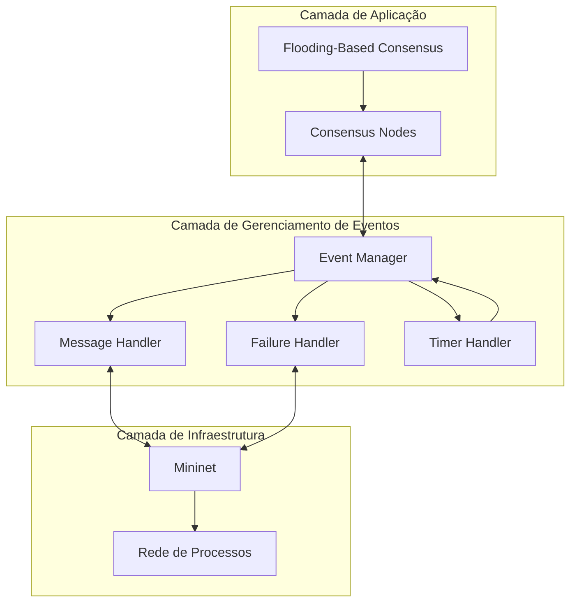
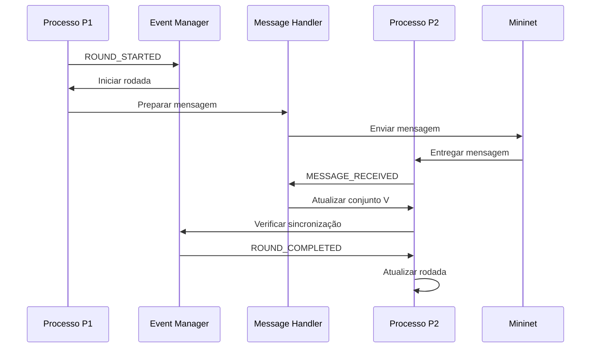
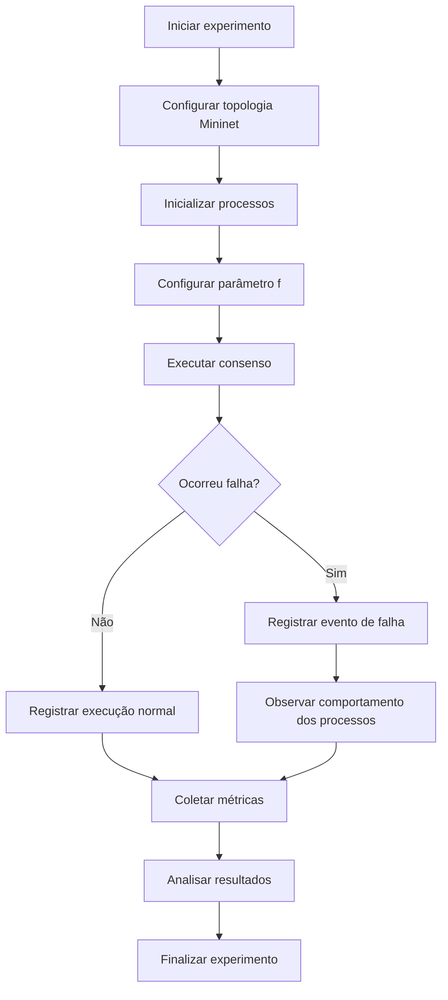

# Arquitetura Orientada a Eventos para Execução do Flooding-Based Consensus com Mininet

## 1. Introdução

Este documento apresenta uma proposta de **arquitetura orientada a eventos (Event-Driven Architecture)** para implementação e avaliação do algoritmo **Flooding-Based Consensus** em um ambiente de redes emuladas utilizando o **Mininet**.

A proposta busca separar a execução do protocolo de consenso, o gerenciamento de eventos e a infraestrutura de comunicação, permitindo avaliar o comportamento do algoritmo em diferentes cenários de rede e condições de falhas.

A arquitetura deverá permitir:
- Execução independente dos processos distribuídos.
- Comunicação entre processos por troca de mensagens.
- Gerenciamento de eventos assíncronos.
- Controle de rodadas do algoritmo de consenso.
- Simulação de falhas de processos e comunicação.
- Monitoramento e coleta de métricas experimentais.

---

## 2. Visão Geral da Arquitetura

A arquitetura será organizada em três camadas principais:

1. **Camada de aplicação:** responsável pela execução do algoritmo de consenso.
2. **Camada de gerenciamento de eventos:** responsável pelo tratamento de mensagens, sincronização e eventos de falhas.
3. **Camada de infraestrutura:** responsável pela comunicação entre os processos utilizando o Mininet.

### 2.1. Diagrama Conceitual



---

## 3. Componentes da Arquitetura

### 3.1. Consensus Node

Cada nó representa um processo independente do sistema distribuído e executa uma instância do algoritmo *Flooding-Based Consensus*.

**Responsabilidades:**
- Armazenar o identificador do processo.
- Manter seu valor inicial.
- Armazenar o conjunto de valores conhecidos.
- Controlar o número da rodada atual.
- Enviar mensagens aos demais processos.
- Processar mensagens recebidas.
- Verificar as condições para avançar de rodada.
- Calcular o resultado final do consenso.

**Principais variáveis locais:**

| Variável | Descrição |
| :--- | :--- |
| `process_id` | Identificador do processo. |
| $v_i$ | Valor inicial do processo. |
| $V$ | Conjunto de valores conhecidos. |
| $r$ | Rodada atual. |
| $f$ | Limite máximo de falhas toleradas. |
| $d_i$ | Valor final calculado pelo processo. |

A decisão final é calculada por:

$$d_i = \min(V)$$

### 3.2. Event Manager

O **Event Manager** é responsável pelo gerenciamento dos eventos da arquitetura, funcionando como mecanismo de coordenação entre os componentes para que cada processo reaja aos acontecimentos da execução.

**Eventos previstos:**

| Evento | Descrição |
| :--- | :--- |
| `MESSAGE_RECEIVED` | Recebimento de uma mensagem. |
| `MESSAGE_SENT` | Envio de uma mensagem. |
| `ROUND_STARTED` | Início de uma rodada. |
| `ROUND_COMPLETED` | Conclusão de uma rodada. |
| `NODE_FAILURE` | Falha de um processo. |
| `NODE_RECOVERY` | Recuperação de um processo. |
| `LINK_FAILURE` | Falha de um enlace. |
| `LINK_RECOVERY` | Recuperação de um enlace. |
| `CONSENSUS_REACHED` | Finalização do consenso. |

> **Nota:** O *Event Manager* não deve substituir a lógica do protocolo. Sua função é organizar o tratamento dos acontecimentos e encaminhá-los aos componentes responsáveis.

### 3.3. Message Handler

O **Message Handler** é responsável pelo tratamento das mensagens trocadas entre os processos. Quando uma mensagem é recebida, o componente deverá:

1. Identificar o processo remetente.
2. Identificar a rodada associada à mensagem.
3. Extrair os valores transmitidos.
4. Atualizar o conjunto local de valores conhecidos.
5. Atualizar o controle de recebimento de mensagens.
6. Verificar se existem condições para avançar de rodada.

O mecanismo de disseminação deverá respeitar a regra do algoritmo original: **cada processo encaminha aos demais os valores que ainda não foram enviados a eles**.

### 3.4. Failure Handler

O **Failure Handler** gerencia os eventos relacionados a falhas, permitindo representar diferentes situações experimentais:
- Falhas de processos.
- Interrupção de comunicação.
- Perda de mensagens.
- Desconexão de enlaces.
- Recuperação de processos.
- Recuperação de enlaces.

> **Importante:** É fundamental distinguir falhas de processos de falhas de comunicação, pois elas podem produzir efeitos diferentes sobre a execução do consenso. O *Failure Handler* deverá registrar os eventos ocorridos, permitindo correlacioná-los posteriormente com os resultados da execução.

### 3.5. Timer Handler

O **Timer Handler** gerencia os temporizadores utilizados na arquitetura. Suas funções incluem:
- Controlar tempos de espera.
- Registrar atrasos de comunicação.
- Identificar situações de *timeout*.
- Auxiliar na identificação experimental de processos que não respondem.

> **Observação:** Um *timeout*, isoladamente, não comprova que um processo falhou. Em redes distribuídas, um processo pode estar apenas respondendo lentamente. Por isso, a utilização de temporizadores deverá respeitar o modelo de falhas e as premissas de sincronização adotadas pelo protocolo.

### 3.6. Mininet

O **Mininet** será utilizado como infraestrutura de emulação da rede, onde cada processo do algoritmo será executado em um *host* virtual independente.

**Parâmetros configuráveis da infraestrutura:**
- Quantidade de processos.
- Topologias de rede.
- Enlaces de comunicação.
- Atrasos de transmissão.
- Largura de banda.
- Perda de pacotes.
- Interrupções de enlaces.

A comunicação entre os processos poderá utilizar sockets **TCP** ou **UDP**, conforme as necessidades da implementação.

---

## 4. Fluxo de Execução do Algoritmo

Considere uma rede composta pelos processos:

$$P = \{P_1, P_2, P_3, P_4, P_5\}$$

Cada processo possui um valor inicial:

$$V_1 = \{10\}, \quad V_2 = \{20\}, \quad V_3 = \{5\}, \quad V_4 = \{15\}, \quad V_5 = \{30\}$$

Considere também que o algoritmo está configurado para tolerar até uma falha ($f = 1$). Consequentemente, o número de rodadas será:

$$R = f + 1 = 2$$

### 4.1. Inicialização

Cada processo inicializa suas estruturas locais (o mesmo procedimento é realizado pelos demais processos):

```text
Processo P1:
V = {10}
r = 1

Processo P2:
V = {20}
r = 1
```

### 4.2. Início da Rodada

O *Event Manager* dispara o evento correspondente e cada processo inicia a execução da rodada:

```text
ROUND_STARTED
```

### 4.3. Disseminação de Mensagens

Os processos enviam aos demais os valores que ainda não foram transmitidos:

```text
P1 -> P2 : {10}
P1 -> P3 : {10}
P1 -> P4 : {10}
P1 -> P5 : {10}
```
*(O mesmo procedimento ocorre nos outros processos).*

### 4.4. Recebimento de Mensagens

Quando uma mensagem chega ao destino, o *Message Handler* dispara o evento `MESSAGE_RECEIVED` e o processo atualiza seu conjunto de valores conhecidos:

```text
Antes:
V = {10}

Após receber mensagem de P2:
V = {10, 20}
```

### 4.5. Sincronização

Cada processo verifica se recebeu as mensagens necessárias para concluir a rodada. Quando a condição de sincronização é satisfeita, o evento abaixo é registrado:

```text
ROUND_COMPLETED
```

O processo incrementa o contador da rodada e inicia a próxima. A implementação deverá preservar a condição de recebimento definida pelo algoritmo original, considerando os processos classificados como corretos.

### 4.6. Finalização

Após a execução das rodadas previstas, cada processo calcula:

$$d_i = \min(V)$$

No exemplo apresentado, considerando a disseminação completa dos valores, temos:

$$d_i = 5$$

Assim, todos os processos corretos deverão obter o mesmo resultado, desde que as premissas de correção do algoritmo sejam satisfeitas.

### 4.7. Diagrama de Sequência



---

## 5. Organização dos Módulos de Software

Uma possível organização da implementação em Python seria:

```text
flooding-consensus/
│
├── main.py
│
├── consensus/
│   ├── __init__.py
│   ├── consensus_node.py
│   ├── flooding_algorithm.py
│   └── round_manager.py
│
├── events/
│   ├── __init__.py
│   ├── event_manager.py
│   ├── message_handler.py
│   ├── failure_handler.py
│   └── timer_handler.py
│
├── communication/
│   ├── __init__.py
│   ├── message.py
│   ├── socket_manager.py
│   └── communication_manager.py
│
├── mininet/
│   ├── topology.py
│   └── network_manager.py
│
├── experiments/
│   ├── experiment_manager.py
│   ├── failure_scenarios.py
│   └── metrics_collector.py
│
└── results/
    ├── logs/
    └── metrics/
```

### 5.1. Responsabilidade dos Módulos

| Módulo | Responsabilidade |
| :--- | :--- |
| `main.py` | Inicialização da aplicação. |
| `consensus_node.py` | Representação dos processos. |
| `flooding_algorithm.py` | Implementação do algoritmo. |
| `round_manager.py` | Controle das rodadas. |
| `event_manager.py` | Gerenciamento dos eventos. |
| `message_handler.py` | Tratamento das mensagens recebidas. |
| `failure_handler.py` | Gerenciamento das falhas. |
| `timer_handler.py` | Gerenciamento dos temporizadores. |
| `message.py` | Definição da estrutura das mensagens. |
| `socket_manager.py` | Comunicação entre processos. |
| `topology.py` | Definição da topologia da rede. |
| `network_manager.py` | Gerenciamento do Mininet. |
| `experiment_manager.py` | Controle dos experimentos. |
| `failure_scenarios.py` | Configuração dos cenários de falhas. |
| `metrics_collector.py` | Coleta das métricas. |

---

## 6. Cenários Experimentais

A arquitetura permitirá avaliar o comportamento do algoritmo em diferentes condições:

### 6.1. Cenário 1: Rede sem Falhas
- **Objetivo:** Avaliar o comportamento básico do algoritmo.
- **Configuração:**
  - Todos os processos permanecem ativos.
  - Todos os enlaces permanecem disponíveis.
  - Não ocorre perda de mensagens.
- **Métricas:** Tempo de execução, quantidade de mensagens, tempo de convergência e consistência dos resultados.

### 6.2. Cenário 2: Falhas de Processos
- **Objetivo:** Avaliar a tolerância a falhas de processos.
- **Configuração:**
  - Alguns processos são interrompidos durante a execução.
  - A quantidade de falhas é mantida dentro do limite configurado.
  - Os demais processos continuam executando.
- **Resultado esperado:** Verificar se os processos corretos conseguem concluir o algoritmo.

### 6.3. Cenário 3: Falhas Acima do Limite Tolerado
- **Objetivo:** Observar o comportamento do algoritmo quando o limite de falhas é ultrapassado.
- **Configuração:**
  - O sistema é configurado para tolerar até $f$ falhas.
  - São provocadas mais de $f$ falhas.
- **Resultado esperado:** Nesse cenário, as garantias do algoritmo deixam de ser asseguradas. O objetivo será observar os efeitos sobre a execução e os resultados.

### 6.4. Cenário 4: Falhas de Comunicação
- **Objetivo:** Avaliar os efeitos de interrupções na infraestrutura de comunicação.
- **Configuração:**
  - Interrupção de enlaces.
  - Aumento de atrasos.
  - Perda de pacotes.
  - Recuperação de conexões.
- **Resultado esperado:** Investigar a influência das condições da rede sobre a sincronização dos processos.

### 6.5. Fluxo dos Experimentos



---

## 7. Métricas de Avaliação

A arquitetura deverá disponibilizar mecanismos para coletar métricas durante os experimentos, que poderão ser armazenadas em arquivos **CSV** ou **JSON** para posterior análise.

| Métrica | Descrição |
| :--- | :--- |
| **Tempo de convergência** | Tempo necessário para finalizar o consenso. |
| **Número de mensagens** | Total de mensagens transmitidas. |
| **Volume de dados** | Quantidade de bytes transmitidos. |
| **Tempo de processamento** | Tempo gasto na execução local do algoritmo. |
| **Número de falhas** | Quantidade de falhas provocadas durante o experimento. |
| **Rodadas executadas** | Número de rodadas realizadas. |
| **Consistência** | Verificação da igualdade dos resultados dos processos corretos. |

### 7.1. Exemplo de Registro de Métricas

```json
{
    "experiment_id": 1,
    "processes": 5,
    "fault_limit": 1,
    "rounds": 2,
    "failures": 1,
    "messages_sent": 20,
    "execution_time": 2.5,
    "consensus_values": [5, 5, 5, 5],
    "consensus_reached": true
}
```
*(Os valores apresentados são meramente ilustrativos).*

---

## 8. Tecnologias Propostas

| Tecnologia | Utilização |
| :--- | :--- |
| **Python** | Implementação dos processos e da lógica do protocolo. |
| **Mininet** | Emulação da infraestrutura de rede. |
| **Linux** | Ambiente de execução. |
| **TCP/UDP Sockets** | Comunicação entre processos. |
| **Asyncio** *(ou equivalente)* | Implementação do tratamento orientado a eventos. |
| **CSV/JSON** | Armazenamento dos resultados. |
| **Matplotlib** | Visualização dos resultados experimentais. |

---

## 9. Considerações sobre Sincronização e Modelo de Falhas

Um aspecto fundamental da arquitetura é preservar as premissas do algoritmo original. A utilização de uma arquitetura orientada a eventos não significa que o protocolo passe a operar em um modelo totalmente assíncrono, pois o *Flooding-Based Consensus* apresentado utiliza rodadas e condições de sincronização.

Portanto, a implementação deverá distinguir claramente:
- Eventos de comunicação.
- Eventos de sincronização.
- Falhas de processos.
- Falhas de comunicação.

Além disso, o parâmetro $f$ representa o **limite máximo de falhas toleradas**, e não a quantidade de falhas efetivamente ocorridas. A implementação deverá definir explicitamente como os processos considerados corretos são identificados e como as condições de recebimento de mensagens são verificadas, respeitando as hipóteses do algoritmo sobre a rede, a comunicação e o comportamento dos processos.

---

## 10. Possível Contribuição Científica

A proposta permite explorar uma arquitetura reutilizável para implementação e avaliação experimental de protocolos distribuídos. O *Flooding-Based Consensus* será utilizado inicialmente como estudo de caso, podendo ser estendido posteriormente para outros protocolos de consenso e algoritmos distribuídos.

Uma possível contribuição científica consiste em investigar como uma arquitetura orientada a eventos pode facilitar:
- A implementação de protocolos distribuídos.
- A experimentação com diferentes modelos de falhas.
- A avaliação do desempenho de algoritmos de consenso.
- A reprodução de cenários experimentais.
- A comparação entre diferentes protocolos.

---

## 11. Considerações Finais

A arquitetura proposta busca estabelecer uma separação clara entre a lógica do protocolo de consenso, o gerenciamento dos eventos e a infraestrutura de comunicação. O Mininet fornecerá o ambiente de emulação, enquanto os processos independentes executarão o algoritmo *Flooding-Based Consensus*.

O gerenciamento orientado a eventos permitirá organizar o tratamento de mensagens, falhas e sincronização, oferecendo uma base sólida para o desenvolvimento de um ambiente experimental capaz de avaliar o comportamento de protocolos distribuídos sob diferentes condições de comunicação e falhas.